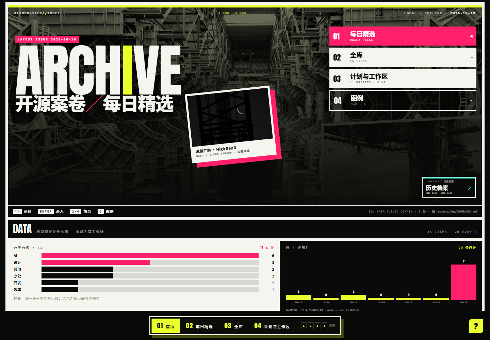
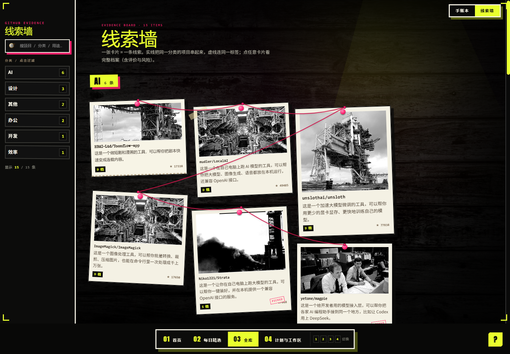
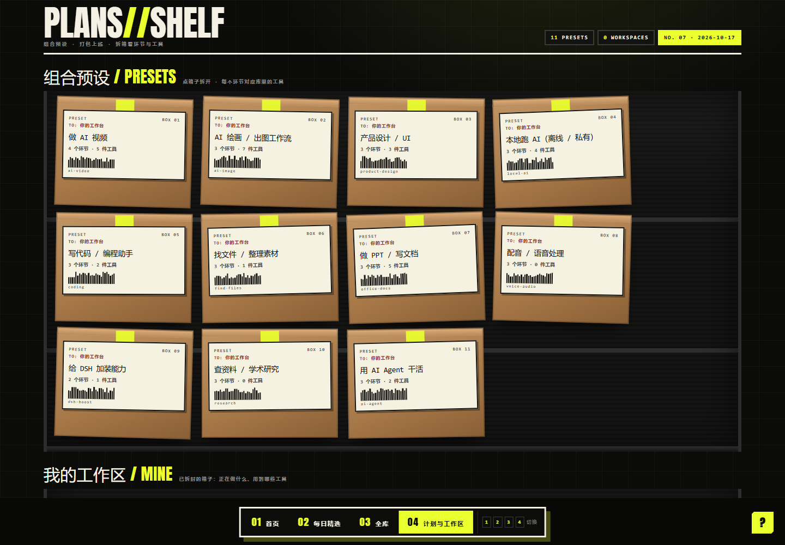

# 开源案卷 · RepoDossier

本地优先的开源项目发现、核验与工具库。发现值得研究的 GitHub 项目，保存来源与证据，用中文理解用途，再按自己的目标查找与组合工具。

原名 **DSH-Skill-Collection**。现在支持 DSH 与 Codex，技能口令 `github-daily-picks`、`tool-stack` 保持兼容。仓库地址：[Kalekaer/RepoDossier](https://github.com/Kalekaer/RepoDossier)。

## 开始使用

1. 从 [Releases](https://github.com/Kalekaer/RepoDossier/releases/latest) 下载发布包和 SHA256 文件，解压到自己的工作目录。
2. Windows 上双击 `打开工具库.cmd`，查看首页、每日精选、全库、计划与工作区。此入口需要 **PowerShell 7、Python 3.9+**；静态文件浏览仍可离线使用。
3. 在 DSH 或 Codex 中打开这个目录，按 `AGENTS.md` 和 `PROMPT-daily.md` 工作。让助手“跑今天的日报”或“我想做某件事，该组合哪些工具”。

包内是 **15 个项目的演示数据**，不含作者的个人项目记录、笔记或工作区。演示日报只用于展示页面，不代表今天已完成采集。页面只读；数据通过脚本与源文件维护。

详细步骤见 [QUICKSTART.md](QUICKSTART.md)。

## 界面

以下截图使用发布包中的演示数据：







## 能做什么

- 按日期与星期生成查询计划，保留完整原始响应，按预算推进分页和分区。
- 将发现、入库、评分、主推荐分别记录；证据缺失保持未完成，不猜分、不凑推荐。
- 保存 README、许可证、发行与讨论证据，使用版本、有效期、内容指纹和条件请求减少重复取数。
- 将项目变化接入复核；查看工具库、每日精选、历史归档和计划。
- 保留断点，换对话后继续同一天同一轮次。

## v1.3.0 的可靠性修复

- 复用既有登录；当前默认要求 GitHub 认证，缺少凭据在请求前停止。凭据只发给官方 API，不传第三方镜像。
- 匿名兼容档 45 次/日，认证档 180 次/日；工作区共享计数。明确未连上的请求退回预占，真实 HTTP 响应与不明超时保守计入。
- 首次网络失败暂停整队；按响应头区分 Search/core 与二级限流，共享冷却。
- README 在同一审阅包、日预算及累计30分钟等待范围内自动续采。
- 重新按查询定义核对计划；删 Q、改可选、擅改每页数量不能过关。缺必跑查询会阻断正式日报页面与发布验收。
- 本机 HTTP 不可用而宿主工具可用时，`collect-daily -NextRequest` 输出少量文件指令，完整响应留在磁盘，避免大 JSON 占上下文。

用法和限制见 [联网与查询执行说明](docs/network-and-query-reliability.md)。新名字的兼容范围见 [改名说明](docs/project-name.md)。

## 数据与质量边界

数据流是原始来源 → 可重建投影 → 页面。`GLOSSARY.md`、`日报结构.md`、`RUBRIC.md` 定义术语、内容与评分。

S+A 主推荐合计不超过8条，S不超过3条；档位与名额分开，不为满额降档。采集是预算采样，工程检查通过不等于总体召回提升、全量覆盖或完成独立质量评审。

新增日报需要 GitHub 网络与有效登录。免费阅读公开 API 不等于无限额度；Search 与普通接口分别限流。镜像只能补充其覆盖的文件，不能替代完整 GitHub 搜索，也未部署全国免代理的统一采集服务。

## 验收和发布

```powershell
pwsh -NoProfile -File tools/check-all.ps1
```

发布包执行9项工程门禁及39项可移植行为测试，不需要安装 Pester；其中 audit 校验168 项不变量（按适用性记录跳过）。真实日报另行检查：

```powershell
pwsh -NoProfile -File tools/check-all.ps1 -Publish -Date YYYY-MM-DD
```

缺查询、缺当期审阅范围或产物不完整时应当失败。发布包构建过程见 [docs/releasing.md](docs/releasing.md)。

许可证与第三方资产见 [LICENSE](LICENSE)、[THIRD-PARTY.md](THIRD-PARTY.md)。
